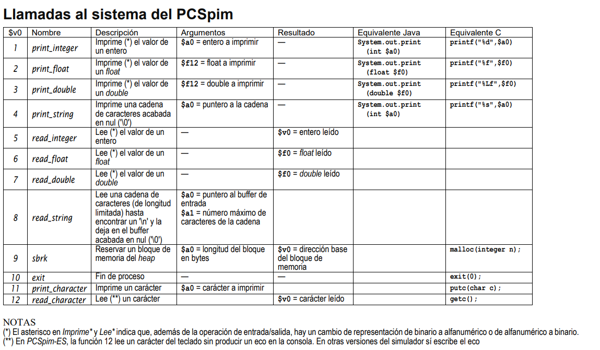

# Apuntes ETC Prácticas
``li``: Guarda valor numérico constante dentro de un registro.

Procesador MIPS trabaja con instrucciones tamaño fijo (32 bits). 
<br>
En una instrucción normal tipo ensamblador, solo hay espacio físico para guardar un número de hasta 16 bits (es decir, valores entre -32.768 y 32.767)

- Si número es pequeño (ej. 25), cabe perfectamente en ***16 bits***, el ensamblador traduce el ``li`` directamente usando un ``ori`` o ``addi`` sencillo con el cero`.
- ¿Qué pasa si el número es gigante o supera los 16 bits? (ej. 753689 o dirección de memoria `0x10000000`) no cabe de una sola vez en una instrucción máquina.

Por eso, el ensamblador tiene que hacer trucos matemáticos dividiendo el número en dos mitades:
1. Los 16 bits de la parte alta (lo llamamos $K_h$).
2. Los 16 bits de la parte baja (lo llamamos $K_l$).
```c
li $t0, 75369

// lo que es:
// lui (load upper immediate):
// carga valor de 16 bits directamente en la mitad superior (alta) de un registro, rellenando la parte abajo con ceros (0x0000).

// or (or immediate):
// realiza operación lógica OR bit a bit entre un registro y una constante de 16 bits
// rellena o completa mitad inferior (baja)
lui $at, 0x0001
ori $t0, $at, 0x2669
```
 Pasamos 75369 a hexadecimal, da 0x12669, ocupa 17 bits (+ de 16 bits) 
 <br>
 ``lui 0x0001``, ``ori 2669``

---

ejemplo:
```cs
.globl __start
.text 0x00400000
__start: li $t0, 25
         li $t1, 30
         add $s0, $t1, $t0
         add $s0, $s0, $s0
```

---

`la` (Load Address):
<br>
Copiar la dirección de memoria de una etiqueta directamente en un registro.

---
### Instrucción de Manipulación de Datos y Lógicas

`move` (Pseudoinstrucción):
<br>
copia el contenido de un registro a otro (ej. ***move rs, rt***).

`addi` (Add Immediate):
<br>
suma el valor de un registro con un número constante pequeño (de 16 bits, llamado "inmediato") y guarda el resultado en otro registro.
(ej. ***addi $t0, $zero, 100***)

`and` (And Immediate):
<br>
operación lógica AND entre un registro y una constante numérica de 16 bits.
(ej. ***andi $t0, $1, 0xFFFF*** sirve para ).

### Instrucciones de Acceso a Memoria (Lectura y Escritura)
`lw` (Load Word):
<br>
lee palabra (4 bytes) desde una dirección en una memoria principal (RAM) y la carga dentro de un registro.

`sw` (Store Word):
<br>
lo contrario que ***lw***, coge el valor que tienes guardado en un registro y lo guarda en la memoria principal.

`sh` (Store Halfword):
<br>
guarda solo media palabra (2 bytes) desde un registro hacia la memoria principal.

### Interacción con el Sistema
`syscall` (System Call):
<br>
instrucción máquina especial que ***detiene temporalmente la ejecución normal del programa*** y ***transfiere el control al sistema operativo para pedirle un servicio*** (como imprimir un número en pantalla, leer por teclado, terminar el programa, etc.)
Simpre 

---

## Instrucciones de Salto y Bifurcación
### A. Instrucciones Máquina Nativas (Directas)
salto incondicional a la etiqueta eti
```cs
j eti 
// o
b eti 
``` 

salta a eti si $rs == $rt
```cs
beq $rs, $rt, eti 
```

salta a eti si $rs != $rt
```cs
bne $rs, $rt, eti
```

salta si $rs > 0
```cs
bgtz $rs, eti
```

salta si $rs <= 0
```cs
blez $rs, $rt, eti
```

salta si $rs < 0
```cs
bltz $rs, $rt, eti
```

salta si $rs >= 0
```cs
bgez $rs, $rt, eti
```

### B. Pseudoinstrucciones Comunes
salta a eti si $rs == 0
```cs
beqz $rs, eti
// se traduce en
beq $rs, $zero, eti
```

salta si $rs != 0
```cs
bnez $rs, eti
```

salta a eti si $rs > rt
```cs
bgt $rs, $rt, eti
```

salta a eti si $rs <= $rt
```cs
ble $rs, $rt, eti
```

salta a eti si $rs < $rt
```cs
blt $rs, $rt, eti
```

salta a eti si $rs >= $rt
```cs
bge $rs, $rt, eti
```

---




