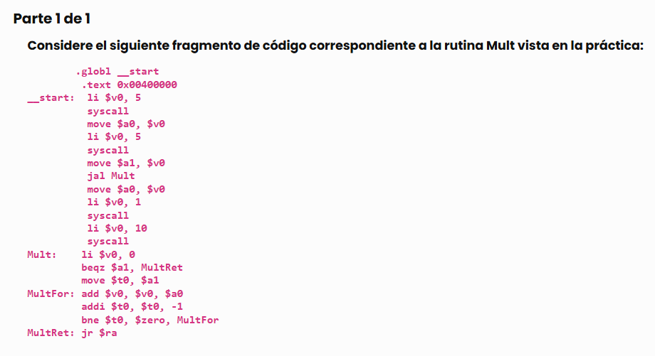

# EJERCICIOS T3
***Teniendo en cuenta el siguiente fragmento de código correspondiente a la rutina Mult vista en la práctica:***
<br>



`jal`:
- guarda en el resgistro $ra la dirección de la siguiente instrucción a ejecutar (PC + 4)
- salta a la dirección de la etiqueta indicada

`jr $ra` (salta a la dirección almacenada en $ra):
- lee dirección guardada dentro del registro $ra 
- actualiza el Contador de Programa (PC/CP) para que el procesador vuelva al punto exacto desde donde fue llamada la función

***¿Cuál es el valor del registro `$ra` tras la ejecución `jal Mult`?***
```cs
$ra = 0x0040001C
```

¿Cómo lo descubrimos?
```cs
li $v0, 5  ->  0x00400000
syscall  ->  0x00400004
move $a0, $v0  ->  0x00400008
li $v0, 5  ->  0x0040000C
syscall  ->  0x004000010
move $a1, $v0  ->  0x004000014
jal Mult  ->  0x004000018
move $a0, $v0  ->  (la instrucción siguiente) 0x00400001C
``` 

***¿Cuál es el valor del CP (Contador de Programa) tras la ejecución de la instrucción `jr $ra` en la rutina Mult?*** 
```cs
CP = 0x0040001C
```

---

ej. 2 ***Indique el valor que se debe escribir en el registro $v0 para invocar las funciones de sistema que se indican:***

```cs
# llamada al sistema exit
li $v0, 10
syscall

#llamada al sistema read_int (lectura de un entero por teclado):
li $v0, 5
syscall
```

---

ej. 3 Complete el código siguiente en MIPS R2000 para imprimir el carácter '=' en consola:
```cs
li $a0, '61'

// imprimir único carácter
li $v0, 11
syscall
```

---

ej. 4 ***Complete el siguiente código MIPSR 2000 para que imprima en consola el entero que se encuentra originalmente en $a1:***
```cs
// imprimir enteros
li $v0, 1

// mover el valor de $a1 a $a0
move $a0, $a1
syscall
```

---

ej. 5 Se desea programar en MIPS R200 lo que indica el siguiente pseudocódigo:
```cs
$a0 = 'M'
$s0 = Input($a0)
```
La función Input el carácter cuyo código se le pasa en $a0, imprime a continuación el símbolo '=' y lee un entero desde el teclado, retornando su valor en el registro $0.
<br>

Complete los espacios en blanco en el siguiente código MIPS equivalente:

```cs
li $a0, 'M'
jal Input
move $s0, $v0
```