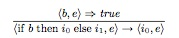

## TEST REPASO TEMA 2
### Indica cuál de las siguientes afirmaciones es **CIERTA**

- **A.** En los lenguajes compilados puros cada instrucción es analizada y ejecutada a la vez, por lo que los programas obtenidos son más eficientes.

> explicación sobre un intérprete

> En la compilación pura, el compilador traduce todo el código fuente de una sola vez a código máquina (lenguaje objeto) antes de ejecutarlo. No va instrucción por instrucción en tiempo de ejecución.
- **B.** Los lenguajes interpretados puros son lenguajes de alto nivel que se traducen a código intermedio.

> Un intérprete puro no genera ningún código intermedio (como el bytecode). Lee la instrucción en código fuente directamente y la ejecuta al momento.

> La traducción a un código intermedio (por ejemplo, el bytecode de Java o C#) es la característica principal de la implementación mixta (compilación intermedia + interpretación por máquina virtual).

- **C.** **En los lenguajes con implementación mixta se traduce del lenguaje original a otro lenguaje intermedio que posteriormente será interpretado. ✅**

- **D.** En los lenguajes compilados puros se traduce del lenguaje original a un lenguaje objeto que posteriormente será interpretado.

> El lenguaje objeto producido por un compilador puro es código máquina nativo ejecutable directamente por el procesador del sistema operativo. Por tanto, NO se interpreta posteriormente.

> El código objeto resultante se ejecuta directamente en el hardware, sin necesidad de ningún intérprete ni máquina virtual de por medio.

**Respuesta correcta: C.**

En una implementación mixta, el programa se traduce primero a un lenguaje intermedio y después ese código es interpretado por una máquina virtual.

 ---

### ¿Qué fase del compilador detecta el error?

Si escribimos en un programa una sentencia incorrecta como esta:

```text
if (x > 0) else x := x + 1 then x := x - 1
```

¿Qué fase del compilador detectará que es incorrecta?

- **A.** El análisis léxico.
- **B.** **El análisis sintáctico. ✅**
- **C.** El análisis semántico.
- **D.** El análisis estático.

**Respuesta correcta: B. Análisis sintáctico.**

La sentencia no respeta la estructura ni el orden que debe tener una instrucción
`if-then-else`. El análisis sintáctico comprueba que los tokens forman una
sentencia válida según la gramática del lenguaje.

 ---

Indica cuál de las siguientes acciones se lleva a cabo en la fase de análisis
semántico durante la compilación de un programa:

- **A.** Dividir la secuencia de caracteres del programa en palabras o tokens.
- **B.** **Comprobar la coincidencia del número de argumentos en una llamada con los parámetros formales de la rutina o función que se invoca. ✅**
- **C.** Enlazar el código objeto con el código resultante de otras compilaciones.
- **D.** Crear la tabla de símbolos.

**Respuesta correcta: B.**

El análisis semántico comprueba que el programa sea coherente con las reglas de
significado del lenguaje. Por ello, verifica que una llamada a una función
tenga el número correcto de argumentos y que estos sean compatibles con sus
parámetros formales.

- La opción **A** corresponde al análisis léxico.
- La opción **C** corresponde a la fase de enlazado.
- La opción **D** está relacionada con la gestión de la tabla de símbolos,
  aunque esta puede comenzar a construirse durante fases anteriores.

 ---

### Nueva operación `=:=` en el lenguaje SIMP

Suponiendo que se amplía la sintaxis del lenguaje SIMP con la instrucción
`X =:= Y` y se añade la siguiente regla a la semántica operacional *small-step*:

```text
〈X, e〉 ⇒ n₀        〈Y, e〉 ⇒ n₁
────────────────────────────────
〈X =:= Y, e〉 → 〈skip, e[X ↦ n₁][Y ↦ n₀]〉
```

¿Cuál de las siguientes afirmaciones define la nueva operación?

- **A.** Es una asignación normal restringida a dos variables, en la que a `X` se le asigna el valor de `Y`.
- **B.** A las dos variables se les asigna un valor inicial.
- **C.** **Se intercambia el valor de las dos variables. ✅**
- **D.** Compara si el valor de las dos variables es el mismo.

**Respuesta correcta: C. Se intercambia el valor de las dos variables.**

La regla evalúa primero `X` y obtiene `n₀`, y después evalúa `Y` y obtiene `n₁`.
Finalmente, actualiza el estado asignando `n₁` a `X` y `n₀` a `Y`:

```text
X ← n₁
Y ← n₀
```

Por tanto, los valores originales de `X` e `Y` quedan intercambiados y la
operación termina en `skip`.

 ---

### Indica cuál de las siguientes afirmaciones es **FALSA**

- **A.** La semántica axiomática es un estilo de definición de semántica dinámica.
- **B.** La semántica dinámica permite observar y analizar propiedades interesantes de los programas, tales como la terminación.
- **C.** La semántica dinámica es una representación del comportamiento del programa en tiempo de ejecución.
- **D.** **La semántica operacional es un estilo de definición de semántica estática. ✅**

**Respuesta correcta: D.**

La semántica operacional pertenece a la **semántica dinámica**, porque describe cómo se ejecuta un programa y cómo evoluciona su estado mediante reglas de transición. La semántica estática, en cambio, analiza propiedades del programa sin ejecutarlo, como los tipos y otras restricciones sintácticas.

Por tanto, la afirmación D es falsa: la semántica operacional es un estilo de definición de **semántica dinámica**.

---

### Precondición más débil

Indica cuál de las siguientes opciones corresponde a la precondición más débil
`P` del siguiente fragmento de programa, con respecto a la postcondición
`Q = (x = a ∧ y = b)`:

```text
x := x + y;
y := x - y;
x := x - y
```

- **A.** **`P = (x = b ∧ y = a)` ✅**
- **B.** `P = (x = y)`
- **C.** `P = (x = a ∧ y = a)`
- **D.** `P = (x = a ∧ y = b)`

**Respuesta correcta: A. `P = (x = b ∧ y = a)`.**

El programa intercambia los valores iniciales de `x` e `y`:

1. Si inicialmente `x = b` e `y = a`, después de `x := x + y` se obtiene
    `x = a + b`.
2. Después de `y := x - y`, resulta `y = b`.
3. Finalmente, `x := x - y` produce `x = a`.

Por tanto, para obtener la postcondición `x = a ∧ y = b`, la precondición más
débil es `x = b ∧ y = a`.

---

### Equivalencia de programas en semántica *big-step*

Dos programas `i₁` e `i₂` son equivalentes (`i₁ ≈ i₂`) si, para cualquier
estado inicial, producen el mismo estado final. Indica cuál de las siguientes
afirmaciones de equivalencia es **incorrecta**:

- **A.** `(y := y) ≈ skip`  
    (`skip` representa la instrucción vacía.)
- **B.** `(x := y; y := x) ≈ (x := y)`
- **C.** `(if x >= 0 then x := x - x else x := x * 0) ≈ (x := 0)`
- **D.** `(x := y; y := x) ≈ (y := x; x := y)`

### Respuesta: **B y D**

La pregunta contiene **dos afirmaciones incorrectas**, no solo una:

- **A es correcta:** `y := y` no modifica el estado, igual que `skip`.
- **B es incorrecta:** `x := y; y := x` deja ambas variables con el valor
    original de `y`, mientras que `x := y` conserva el valor original de `x`.
- **C es correcta:** tanto `x - x` como `x * 0` producen `0`, cualquiera que
    sea el valor de `x`.
- **D es incorrecta:** `x := y; y := x` deja ambas variables con el valor
    original de `y`, mientras que `y := x; x := y` deja ambas con el valor
    original de `x`.

Por tanto, tal como está redactado el ejercicio, las opciones incorrectas son
**B y D**. Si se esperaba una única respuesta, el enunciado debería corregirse.

---

### Ejecución de un paso en semántica *small-step*

Dada la siguiente regla de la semántica operacional de paso pequeño:



¿Cuál es la configuración resultante de ejecutar un paso a partir de la
configuración?

```text
〈if x > 4 then y := 4 else y := 6, {x ↦ 5}〉
```

- **A.** `〈y := 4, {x ↦ 5}〉`
- **B.** `〈y := 6, {x ↦ 5}〉`
- **C.** `〈y := 4, {x ↦ 5, y ↦ 4}〉`
- **D.** `〈y := 6, {x ↦ 5, y ↦ 6}〉`

**Respuesta correcta: A.**

El estado inicial indica que `x = 5`. Por tanto, la condición `x > 4` es
verdadera y se selecciona la rama `then`, cuya instrucción es `y := 4`.
En un único paso todavía no se ejecuta esa asignación; únicamente se reduce
el condicional a la instrucción elegida. Por ello, el estado permanece sin
cambios:

```text
〈if x > 4 then y := 4 else y := 6, {x ↦ 5}〉
    → 〈y := 4, {x ↦ 5}〉
```

---

### Verificación formal de programas

¿Cuál es el estilo de definición semántica más útil para soportar la
verificación formal de programas?

- **A.** Semántica operacional de paso pequeño.
- **B.** Semántica operacional de paso grande.
- **C.** **Semántica axiomática. ✅**
- **D.** Semántica denotacional.

**Respuesta correcta: C. Semántica axiomática.**

La semántica axiomática permite <mark><u>***especificar y demostrar propiedades de los
programas mediante precondiciones, instrucciones y postcondiciones.***</u></mark> Su
principal herramienta es la **lógica de Hoare**, que utiliza
triples de la forma:

```text
{P}  programa  {Q}
```

Este triple indica que, si se cumple la precondición `P` antes de ejecutar el
programa y este termina, entonces se cumple la postcondición `Q`. Por ello,
es especialmente adecuada para la verificación formal y la demostración de
la corrección de los programas.


 

